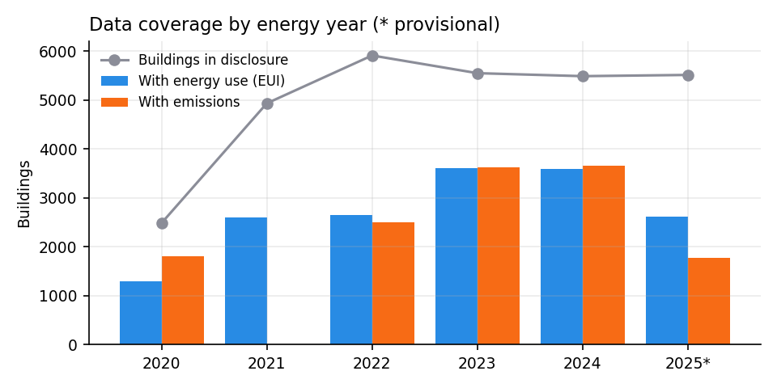
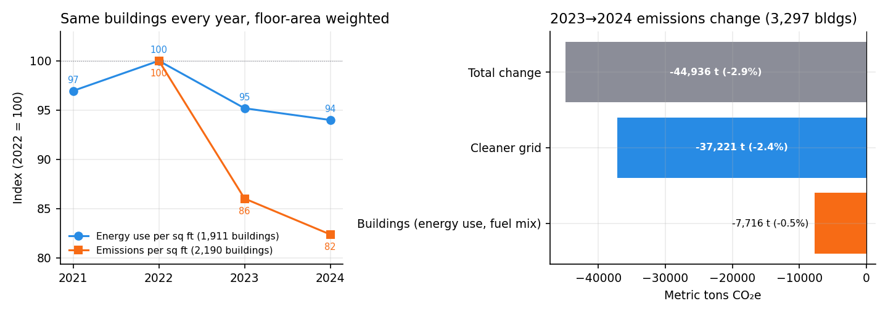
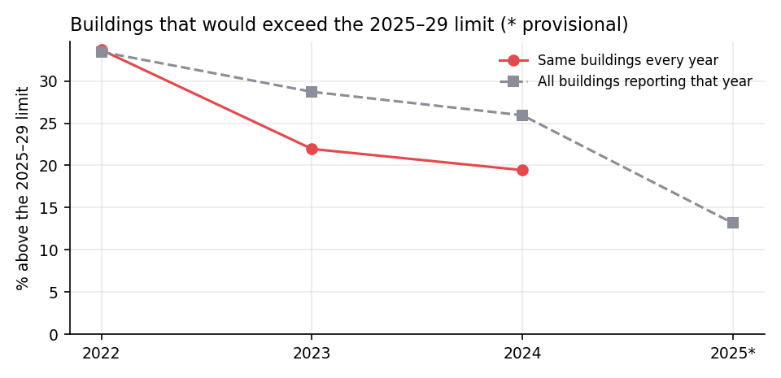
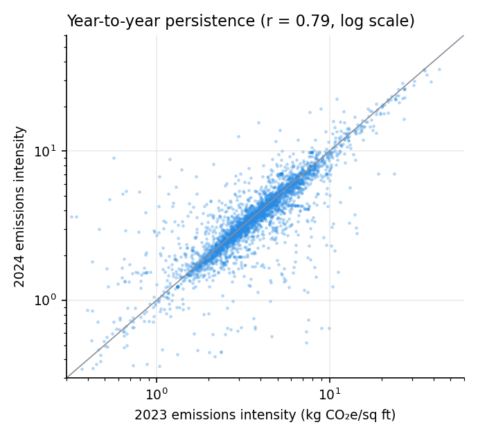
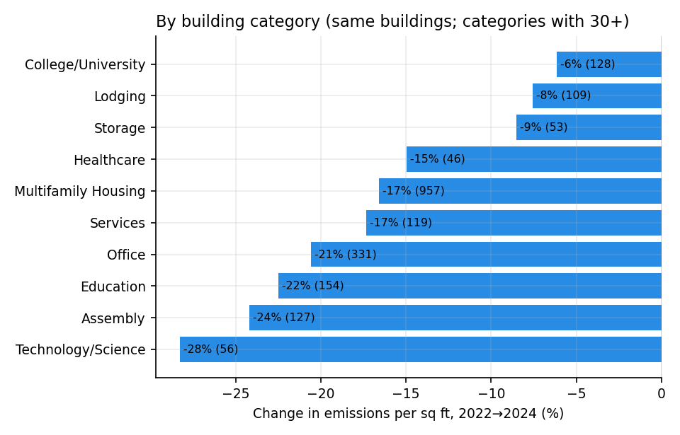

# BERDO time series: energy use and emissions, 2020–2025

How have Boston's covered buildings changed since BERDO reporting began, and how much of the
change comes from the buildings themselves rather than a cleaner power grid?

Run from the repository root:

```bash
python analysis/time_series/time_series.py
```

It reads `data/berdo_<year>.csv` through `berdo.data.prepare_dataframe` (the app's own loader),
prints a summary, and writes the charts in `figures/` and the tables in `tables/`.

## Method

- **Years are energy years.** Each reporting year holds the previous year's energy use
  (reporting year 2026 = 2025 energy use).
- **Balanced panels.** Each trend uses the same buildings in every year, linked by BERDO ID, so a
  change in *which* buildings reported can't look like a change in performance.
- **Citywide figures are floor-area weighted** (total emissions ÷ total floor area). Medians are in
  the tables, since a few very large buildings dominate totals.
- **Grid vs. buildings.** Electricity emissions are restated at the 2023 grid factor (BERDO
  Appendix B × (1 − RPS Class I)). The difference between actual and fixed-grid emissions is the
  grid effect; the rest is the buildings' own change in energy use and fuel mix.
- **Campus records** (whole-campus totals) are excluded, so no building is counted twice.
- **Energy year 2025 is provisional** and is shown separately, never mixed into the panels (see
  Limitations).

## What the data covers



| Energy year | Buildings | With energy use | With emissions | With electricity emissions |
|---|---|---|---|---|
| 2020 | 2,483 | 1,783 | — | — |
| 2021 | 4,933 | 2,599 | — | — |
| 2022 | 5,912 | 2,655 | 2,507 | — |
| 2023 | 5,550 | 3,600 | 3,624 | ✓ |
| 2024 | 5,487 | 3,596 | 3,661 | ✓ |
| 2025* | 5,514 | 2,607 | 1,773 | ✓ |

*Provisional. Emissions are published from energy year 2022, electricity emissions from 2023.

## Findings

### 1. Emissions fell faster than energy use



For the same buildings every year (2022 = 100):

| | 2021 | 2022 | 2023 | 2024 |
|---|---|---|---|---|
| Energy use per sq ft (1,911 buildings) | 97 | 100 | 95 | 94 |
| Emissions per sq ft (2,190 buildings) | — | 100 | 86 | 82 |

Energy use per square foot fell about **6%** from its 2022 peak. Emissions per square foot fell
**18%**, and total emissions for those buildings fell **16.5%**. (2021 energy use was lower than
2022's, likely still reflecting reduced pandemic-era occupancy.)

### 2. Recently, the grid did most of the work

From 2023 to 2024, for 3,297 buildings reporting electricity emissions in both years:

| | Metric tons CO₂e | Share of 2023 emissions |
|---|---|---|
| Total change | −44,936 | −2.9% |
| Cleaner grid | −37,221 | −2.4% |
| Buildings (energy use, fuel mix) | −7,716 | −0.5% |

About **five-sixths of the decline came from cleaner electricity** (grid factor 205 → 195 kg/MWh;
electricity is 47% of these buildings' emissions). The buildings' own improvement was about half
a percent.

**Why it matters:** the 2030–34 limits are roughly 40% stricter than today's for many building
types (offices: 5.3 → 3.2 kg/sq ft). A cleaner grid helps, but at this pace it won't close that gap
alone, especially for buildings heated with gas.

### 3. Fewer buildings would exceed the 2025–29 limit



Among the same 2,190 buildings, the share whose emissions would exceed their 2025–29 limit fell
from **33.7% (2022) to 21.9% (2023) and 19.4% (2024)**. In the provisional 2025 data, 13.2% of
reporting buildings are over, but that figure is likely too low (see Limitations).

### 4. A building's emissions are very persistent



For 3,308 buildings reporting in both 2023 and 2024:

- Emissions intensity in one year strongly predicts the next: **r = 0.79** (log scale).
- **80%** of buildings over their limit in 2023 were still over in 2024.
- Only **4.9%** of buildings under their limit in 2023 went over in 2024.

This is why last year's emissions relative to the limit is the strongest feature in the
prediction model (`analysis/predictions_2026/`): buildings rarely change much from one year to the
next without deliberate action.

### 5. Every major building category improved, unevenly



Change in emissions per square foot, 2022 → 2024, same buildings (categories with 30+ buildings):

| Category | Buildings | Change |
|---|---|---|
| Technology/Science | 56 | −28% |
| Assembly | 127 | −24% |
| Education | 154 | −22% |
| Office | 331 | −21% |
| Services | 119 | −17% |
| Multifamily Housing | 957 | −17% |
| Healthcare | 46 | −15% |
| Storage | 53 | −9% |
| Lodging | 109 | −8% |
| College/University | 128 | −6% |

## Limitations

- **The 2022 → 2023 drop is larger than energy use and the grid explain.** For 2,272 buildings with
  data in both years, emissions per unit of energy fell 9.7%, while the grid factor change (216 →
  205 kg/MWh) accounts for only about 2.4 points. The rest may be fuel switching, but it may also
  reflect a change in how the City calculated emissions between the two disclosures. **Confirm
  with the City before citing the 2022 → 2023 change.** The 2023 → 2024 comparison uses consistent,
  directly reported electricity emissions.
- **Energy year 2025 is provisional and biased.** The City withheld data for buildings under review
  or still reporting, and buildings over their limit are more likely to be under review, so the
  2025 share over the limit is likely an undercount.
- **Panels cover buildings that reported every year** (roughly 2,000–3,300 of about 5,500). Buildings
  that report inconsistently may differ.
- **Limits use sector defaults** for comparability across years, not individual compliance
  schedules or blended portfolio standards.
- **Weather isn't adjusted for.** Colder or hotter years change heating and cooling energy.
- **Floor area as reported.** Corrections to floor area between years change intensity.

## Files

| File | Contents |
|---|---|
| `time_series.py` | The analysis |
| `figures/1_coverage.png` … `5_by_category.png` | Charts |
| `tables/coverage.csv` | Buildings and data availability by year |
| `tables/energy_panel.csv` | Energy use panel, 2021–2024 |
| `tables/emissions_panel.csv` | Emissions panel, 2022–2024 |
| `tables/grid_decomposition_2023_2024.csv` | Grid vs. building change |
| `tables/share_over_2025_limit.csv` | Share over the 2025–29 limit by year |
| `tables/over_limit_transitions_2023_2024.csv` | Over/under transitions between years |
| `tables/intensity_by_category.csv` | Change by building category |
